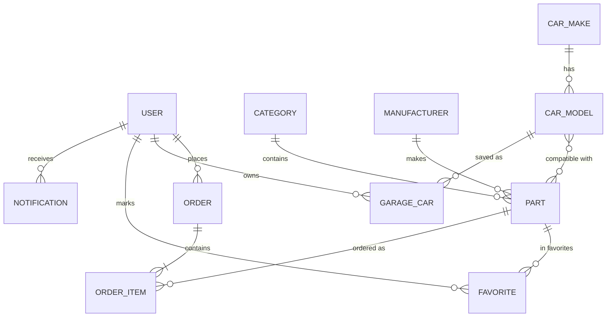

# Автозапчасти — учебный интернет-магазин

Вариант: Д11-М3 (автозапчасти; избранное и уведомления о поступлении).
Автор: Ч... К..., группа ...

## О проекте

Интернет-магазин автозапчастей на Django (SQLite). Покупатель подбирает
запчасти по своему автомобилю, оформляет заказ, следит за заказами.

### Роли
- **Покупатель** — каталог, корзина, заказы, гараж, избранное, уведомления.
- **Менеджер** — ведёт запчасти и остатки, обрабатывает заказы в admin panel.
- **Администратор** — пользователи, права, справочники.

### Сценарии
1. Покупатель может зарегистрироваться, войти и выйти.
2. Покупатель может найти запчасть поиском (без учёта регистра).
3. Покупатель может отфильтровать каталог по цепочке «марка → модель → год».
4. Покупатель может добавить свой автомобиль в «гараж» и смотреть только подходящие запчасти.
5. Покупатель может положить запчасть в корзину (не больше остатка) и оформить заказ.
6. Покупатель получает предупреждение, если запчасть не подходит ни к одному авто из гаража.
7. Покупатель может смотреть историю заказов и отменить новый заказ.
8. Покупатель может добавить запчасть в избранное и получить уведомление, когда она снова появится в наличии.
9. Менеджер может менять статусы заказов и пополнять остатки.

## Модели
(список моделей с полями и связями — дописывается по мере разработки)

## Схема базы данных

## Запуск
(дописывается на этапе 4)